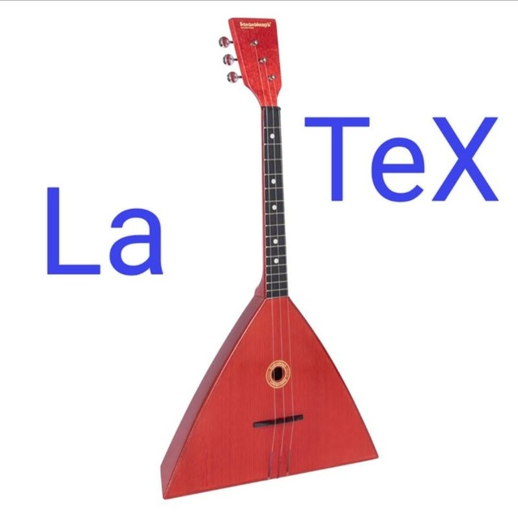

# BlaBlaTex

<div align="center">
  
  <br>
  <strong>Умный редактор LaTeX с искусственным интеллектом</strong><br>
  Генерация кода, решение уравнений, компиляция PDF и многое другое
</div>

<br>

[](https://python.org)
[](https://nodejs.org)
[](https://fastapi.tiangolo.com)
[](https://react.dev)
[](https://typescriptlang.org)
[](https://docker.com)
[](LICENSE)

---

## 📋 О проекте

**BlaBlaTex** — современный онлайн-редактор LaTeX с 26 AI-функциями. Помогает студентам, преподавателям и учёным быстро создавать научные документы: от лабораторных работ до статей ВАК.

### ✨ Ключевые возможности

| Категория | Функции |
|-----------|---------|
| 🤖 **AI Генерация** | Полные документы, формулы, теоремы с доказательствами, определения, примеры |
| 🧮 **Математика** | Решение уравнений, производные, интегралы, физические формулы, проверка формул |
| 📊 **Графика** | Таблицы (booktabs), диаграммы (TikZ), графики (pgfplots) |
| 📚 **Библиография** | Генерация BibTeX, форматирование (IEEE/ГОСТ/APA), проверка ссылок |
| ♿ **Доступность** | Alt-текст для формул, проверка цветов, проверка шаблонов |
| 👥 **Совместная работа** | Сравнение версий, сводки изменений, конспекты документов |
| 🔧 **Компиляция** | pdfLaTeX/XeLaTeX, автоисправление ошибок через AI |

### 🧠 AI-модели (бесплатно)

| Модель | Провайдер | Для чего |
|--------|-----------|----------|
| **Llama 3.1 8B** | Groq | Быстрые задачи: формулы, объяснения, ссылки |
| **Qwen 3 Next 80B** | OpenRouter | Сложные задачи: документы, математика, графика |

> 💡 **Бюджет: $0/месяц.** Используются только бесплатные тарифы.

---

## 🚀 Быстрый старт

### Требования

- **Docker Desktop** (версия 24+)
- **8 ГБ RAM** (рекомендуется 16 ГБ)
- **20 ГБ** свободного места на диске
- **Git**

### 1. Установите Docker Desktop

Скачайте и установите Docker Desktop с официального сайта:  
👉 https://www.docker.com/products/docker-desktop/

Запускайте файл установщика от имени администратора.

### 2. Клонируйте репозиторий

```bash
git clone -b develop https://github.com/Vovaprogrammer/BlaBlaTex.git
cd BlaBlaTex
```

### 3. Настройте переменные окружения

Получите файл **.env** у руководителя и добавьте его в корень проекта:

> 🔑 Там хранятся ключи API.

```env
SUPABASE_URL=https://your-project.supabase.co
SUPABASE_ANON_KEY=your-supabase-anon-key
SECRET_KEY=your-secret-key
GROQ_API_KEY=your-groq-api-key
OPENROUTER_API_KEY=your-openrouter-api-key
```

### 4. Запустите проект

```bash
docker compose up -d
```

### 5. Откройте в браузере

```
http://localhost:5173
```

> ⏱️ **Первый запуск:** 30-40 минут (скачивание Docker-образов и LaTeX)  
> ⚡ **Последующие запуски:** 5-10 секунд

---

## 📁 Структура проекта

```
BlaBlaTex/
├── backend/                    # FastAPI сервер
│   ├── app/
│   │   ├── api/                # API-эндпоинты
│   │   ├── core/               # Конфигурация, JWT
│   │   ├── db/                 # Supabase клиент
│   │   ├── middleware/         # Middleware (UTF-8)
│   │   ├── models/             # SQLAlchemy модели
│   │   ├── schemas/            # Pydantic схемы
│   │   └── services/           # Бизнес-логика (AI, компиляция)
│   ├── Dockerfile
│   └── requirements.txt
├── frontend/                   # React + TypeScript
│   ├── src/
│   │   ├── components/         # React-компоненты
│   │   ├── hooks/              # Пользовательские хуки
│   │   ├── services/           # API-клиент
│   │   └── constants/          # Шаблоны документов
│   ├── Dockerfile
│   └── package.json
├── docker-compose.yml          # Оркестрация контейнеров
├── .env                        # Ключи API (не в Git)
├── .gitignore
├── LICENSE
└── README.md
```

---

## 🎨 Особенности интерфейса

- 🌓 Тёмная и светлая темы с градиентным дизайном
- 🎯 Подсветка синтаксиса LaTeX (как в Overleaf)
- 📑 Номера строк с синхронизацией прокрутки
- 🖱️ Изменяемые панели перетаскиванием
- ✨ Анимации появления результатов
- 📱 Адаптивный дизайн

---

## 👥 Команда

| Роль | Участник |
|------|----------|
| 🧠 Full-stack разработчик | Владимир Чистяков |
| ✅ Тестировщик | Владислав Тесля |
| 💻 Разработчик | Холоднов Иван |
| 🎨 Фронтенд разработчик | Вершинина Кристина |

---

## 📄 Лицензия

MIT License — см. файл LICENSE.

---

## 🙏 Благодарности

- FastAPI — веб-фреймворк
- React — UI-библиотека
- Tailwind CSS — стилизация
- Supabase — база данных и аутентификация
- Groq — быстрый AI-инференс
- OpenRouter — доступ к AI-моделям
- Prism.js — подсветка синтаксиса
- KaTeX — рендеринг математики